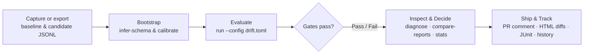

<div align="center">

# llm-drift-bench

**Catch silent regressions before you swap, update, or quantize your LLM.**

Lightweight, deterministic CLI and Python library for offline LLM drift detection, JSON Schema conformity, multi-candidate ranking, statistical significance testing, and agent tool-trace auditing.

[](https://pypi.org/project/llm-drift-bench/)
[](https://github.com/Anantgoel0123456/llm-drift-bench/actions/workflows/ci.yml)
[](pyproject.toml)
[](src/llm_drift_bench/py.typed)
[](LICENSE)

[Quickstart](#quickstart) · [Capabilities](#capabilities) · [Workflows](#core-workflows) · [CLI Reference](#cli-reference) · [Python API](#python-api--pluggable-scorers) · [CI/CD](#cicd-integration) · [Examples](examples/README.md) · [Architecture](docs/architecture.md)

</div>

---

## See it in 18 seconds

[](docs/assets/demo.mp4)

[Watch MP4](docs/assets/demo.mp4) · [Static Preview](docs/assets/demo-poster.png) · [Sample HTML Report](docs/assets/example-report.html) · [Demo Fixtures](examples/README.md)

<sub>Edited from real CLI JSON outputs on handwritten fixtures in <code>examples/</code> (not real model captures or runtime benchmarks). Silent — no audio required.</sub>

---

## Why `llm-drift-bench`?

A quantized checkpoint (e.g. FP16 -> INT4/Q4_K_M), model version bump, or prompt edit can keep returning syntactically valid JSON while quietly dropping a required field, shifting an invoice total, flipping a classification label, or regressing P95 latency.

`llm-drift-bench` compares captured baseline and candidate responses by `prompt_id` **completely offline** — no LLM judge API calls, no embedding downloads, and no GPU required. Core models are pure stdlib dataclasses with PEP 562 lazy loading (**~8 ms** package import; canonical runs never eagerly import Pydantic or Rich).



> [!IMPORTANT]
> **Agreement is not factual correctness.** Metrics are deterministic lexical, structural, numeric, and statistical signals against your baseline — not an LLM-as-a-judge or semantic truth oracle.

---

## Capabilities

| Capability | Highlights |
| :--- | :--- |
| **JSON & Schema Conformity** | Strict extraction (direct, fenced, prose), duplicate-key & `NaN`/`Inf` rejection, safe bounded regex subset |
| **Composite Drift & Policies** | Token Jaccard, n-gram Dice, exact Levenshtein, JSON structure/field/numeric drift, `drift.toml` weights & per-field/wildcard `[*]` rules (`ignore`, `unordered_array`, `tolerance_abs`/`tolerance_rel`) |
| **Semantic Field Diffs & Distributions** | `diff` CLI inspects per-prompt JSON field/text diffs; `distribution` catches cross-prompt soft slides (categorical TVD/JSD & numeric quantiles + 1D Wasserstein) even when every JSON passes schema |
| **Zero-Setup Onboarding** | `wizard` asks 5 plain-English questions (or `--preset`) to build `drift.toml`; `infer-schema` generates strict JSON Schemas; `calibrate` auto-tunes `drift.toml`, collapses volatile arrays to `[*]`, & suggests `--numeric-tolerances`; `lint-suite` & `doctor` audit suites, hygiene, and leaked credentials |
| **Endpoint Capture Collector** | Zero-dependency OpenAI-compatible, Anthropic (`--provider anthropic`), & Gemini (`--provider gemini`) collector with `--concurrency`, `--runs`, `--json-mode`, `--top-logprobs`, `--resume`, `--header`, `Retry-After` backoff, & connection-drop retries |
| **Token Logprobs & Quality Checks** | `logprobs` measures Shannon entropy & position-aligned top-k JSD before greedy decoding flips tokens; `check-quality` catches repetition loops, refusal flips, truncation, & verbosity blowups |
| **Multi-Candidate Ranking** | `compare-many`, `compare-reports` (`--markdown-output`, SVG Pareto HTML, Rich tables), & `matrix` Prompt x Candidate heatmaps (text, JSON, offline HTML) |
| **Privacy, Sampling & Release Gates** | `redact` (secrets + optional PII), `subsample` (stratified suite & lockstep capture slicing), `snapshot` (SHA-256 fixture integrity), `cost` (explicit tokens only), & `gate` composite GO/NO-GO verdicts |
| **Statistical Rigor** | `stats` with deterministic bootstrap CIs, Wilson score intervals, Holm-Bonferroni correction, flaky-prompt detection, paired permutation tests (Cohen's `d`), and exact McNemar conformity tests |
| **Drift History & Trends** | Append-only JSONL ledger (`history record\|show\|check\|summary\|prune`) with moving-window alerts, atomic compaction, `--candidate`/`--tag` filters, sparklines & SVG trend HTML |
| **Agent Tool-Trace Audits** | `check-tools --adapter normalized\|openai\|anthropic\|gemini\|otel` (OpenAI Responses, Gemini `functionCall`, & OTLP `resourceSpans`), `--max-failed-calls` retry budgets, & secret-leak checks |
| **Pluggable Scorers** | `score` CLI + pure-stdlib `char_ngram_cosine`, `json_key_jaccard`, `markdown_structure`, `numeric_prose`, `python_ast`, `tfidf_cosine` + `llm_drift_bench.scorers` entry points |
| **CI-Native Exports** | Table, Rich, JSON, CSV, SARIF 2.1.0, Markdown, GitHub PR comments (`--previous` deltas), offline HTML (`--include-diffs`), JUnit XML, `--github-summary` |

---

## Quickstart

Requires **Python 3.10+**. Install the latest published release from PyPI or install this checkout in editable mode:

```bash
# Option A: Install from PyPI
pip install llm-drift-bench

# Option B: Install from source
git clone https://github.com/Anantgoel0123456/llm-drift-bench.git
cd llm-drift-bench
python -m venv .venv
.venv/bin/python -m pip install -e .        # Windows PowerShell: .\.venv\Scripts\python.exe -m pip install -e .
```

Run the bundled offline demo (exit `0` on pass, exit `1` on drift):

```bash
# 1. Passing comparison (exit 0)
python -m llm_drift_bench run \
  -b examples/baseline.jsonl \
  -c examples/candidate-pass.jsonl \
  -s examples/extraction-suite.json

# 2. Catch a regression and save the report (exit 1)
python -m llm_drift_bench run \
  -b examples/baseline.jsonl \
  -c examples/candidate-drift.jsonl \
  -s examples/extraction-suite.json \
  -o drift-report.json

# 3. Explain exactly why it failed & inspect exact field-level diffs (exit 0)
python -m llm_drift_bench diagnose -i drift-report.json
python -m llm_drift_bench diff -b examples/baseline.jsonl -c examples/candidate-drift.jsonl --only-changed
```

<details>
<summary><strong>Preview actual terminal output (failing run + diagnose)</strong></summary>

```text
==============================================================================
 LLM DRIFT BENCHMARK REPORT  [FAILED]
==============================================================================
 Baseline Model  : demo-reference
 Candidate Model : demo-candidate-drift
 Total Samples   : 2 (Drifted: 2 / 100.0%)
------------------------------------------------------------------------------
 Metric                               | Baseline         | Candidate / Value
------------------------------------------------------------------------------
 JSON Conformity Rate                 |          100.0% |             50.0%
 Mean Composite Drift                 |     0.0000 (ref) |             0.6694
 Max Composite Drift                  |     0.0000 (ref) |             0.9597
 Mean Token Jaccard Similarity        |     1.0000 (ref) |             0.5238
 Mean Levenshtein Similarity          |     1.0000 (ref) |             0.5142
 Mean JSON Structural Similarity      |     1.0000 (ref) |             0.5000
 Mean JSON Numeric Relative Drift     |     0.0000 (ref) |             0.4444
 P50 Latency (ms)                     |              n/a |                n/a
 P95 Latency (ms)                     |              n/a |                n/a
 Latency regression check: n/a (incomplete measurements).
------------------------------------------------------------------------------
 Prompt ID          | Category       | JSON OK | Struct Sim | Drift    | State
------------------------------------------------------------------------------
 invoice-01         | extraction     | YES     |     1.0000 |   0.3791 | DRIFT
 ticket-01          | classification | NO      |     0.0000 |   0.9597 | DRIFT
==============================================================================
 Threshold Violations:
  - 2 of 2 samples failed individual drift checks.
  - Mean composite drift (0.6694) exceeded threshold (0.2500).
  - Candidate JSON conformity rate (50.00%) fell below minimum (95.00%).
  - Mean numeric relative drift (0.4444) exceeded threshold (0.1500).
==============================================================================
```

```text
Benchmark FAILED
[schema] ticket-01: $.priority: required
  Try: Restore the required field in the extraction prompt or output mapping.
[numeric_change] invoice-01: Shared numeric fields have relative drift 0.4444.
  Try: Compare units, decimal placement and rounding against the source record.
```

</details>

---

## Core Workflows

### 1. Zero-Setup Onboarding (`infer-schema` & `calibrate`)

Skip writing JSON Schemas and guessing thresholds by hand:

```bash
# Auto-infer a strict prompts.json schema suite from captured baseline JSON outputs
python -m llm_drift_bench infer-schema -i examples/baseline.jsonl -o inferred-prompts.json --strict-additional

# Validate captures immediately against the inferred schema
python -m llm_drift_bench validate -i examples/baseline.jsonl -p inferred-prompts.json --strict

# Auto-calibrate drift.toml (thresholds + ignore rules for volatile fields like $.timestamp)
python -m llm_drift_bench calibrate --baseline-a baseline-run1.jsonl --baseline-b baseline-run2.jsonl -o drift.toml
```

### 2. Task-Specific `drift.toml` Policies

Customize metric weights, ignore volatile fields, compare order-insensitive arrays, set absolute/relative numeric tolerances, or handle >16,384-char responses (see [examples/drift.toml](examples/drift.toml)):

```toml
long_text_mode = "skip_levenshtein" # or "error" (default)

[thresholds]
max_composite_drift = 0.20
min_json_conformity_rate = 0.98
max_numeric_relative_drift = 0.05
max_latency_regression_pct = 35.0

[fields."$.items[*].timestamp"]
ignore = true

[fields."$.tags"]
unordered_array = true

[fields."$.confidence"]
tolerance_abs = 0.03
```

```bash
python -m llm_drift_bench run \
  -b examples/baseline.jsonl -c examples/candidate-pass.jsonl \
  -s examples/extraction-suite.json --config examples/drift.toml

# Inspect only semantic changes not suppressed by drift.toml
python -m llm_drift_bench diff \
  -b examples/baseline.jsonl -c examples/candidate-drift.jsonl \
  --config examples/drift.toml --only-changed
```

### 3. Capture Reproducible Outputs (`capture`)

Collect deterministic JSONL captures directly from any OpenAI-compatible endpoint (**Ollama**, **vLLM**, **llama.cpp server**, **OpenAI**) with bounded concurrency, multi-run repeats, JSON mode, crash-resilient `--resume` checkpointing, custom gateway `--header` flags, explicit timeouts, bounded retries, and env-var secret handling:

```bash
python -m llm_drift_bench capture \
  -s examples/extraction-suite.json \
  --endpoint http://localhost:11434/v1 \
  --model llama3:8b-q4_K_M \
  --seed 42 --concurrency 4 --runs 3 --json-mode --resume \
  --header "X-Title: DriftBench" \
  -o candidate.jsonl
```

### 4. Multi-Candidate Ranking & Visual Reports

Compare multiple quantizations or prompts side-by-side, inspect hotspots, gate on newly regressed prompts, and export zero-JS offline HTML dashboards or compact GitHub PR comments:

```bash
# Evaluate multiple captures against one baseline and flag regressions vs a reference candidate
python -m llm_drift_bench compare-many \
  -b examples/baseline.jsonl -s examples/extraction-suite.json \
  -c q8 examples/candidate-pass.jsonl \
  -c q4 examples/candidate-drift.jsonl \
  --against q8 --hotspots 5 --format rich --html-output comparison.html

# Rank saved reports with an inline SVG Pareto frontier dashboard
python -m llm_drift_bench compare-reports examples/expected-pass.json examples/expected-drift.json \
  --sort-by passed --by-category --rule-summary --numeric-changes 5 --html-output pareto.html

# Export a compact GitHub PR comment with deltas vs a previous run
python -m llm_drift_bench report -i examples/expected-drift.json \
  --format pr-comment --previous examples/expected-pass.json

# Export a standalone offline HTML report with collapsible side-by-side JSON field diffs
python -m llm_drift_bench run \
  -b examples/baseline.jsonl -c examples/candidate-drift.jsonl \
  -s examples/extraction-suite.json --format html --include-diffs --no-fail-on-drift > report.html
```

### 5. Statistical Significance & Drift History (`stats` & `history`)

Distinguish real regressions from sampling variance and track model quality across releases:

```bash
# Bootstrap CIs, flaky prompt detection, paired permutation & exact McNemar conformity tests
python -m llm_drift_bench stats run1.json run2.json run3.json \
  --compare-against baseline-ref.json --confidence 0.95

# Append runs to an audit ledger, render trends, and gate on gradual degradation
python -m llm_drift_bench history record --ledger drift-history.jsonl -i examples/expected-pass.json --tag q8 --git-sha abc1234
python -m llm_drift_bench history show --ledger drift-history.jsonl --candidate demo-candidate-pass --format text
python -m llm_drift_bench history show --ledger drift-history.jsonl --format html -o trends.html
python -m llm_drift_bench history check --ledger drift-history.jsonl --window 3 --max-drift-increase 0.05
```

### 6. Offline Agent Tool-Trace Audits (`check-tools`)

Verify that an agent read required content before editing — directly on normalized traces, **OpenAI** Chat/Responses transcripts, **Anthropic/Claude** `tool_use`/`tool_result` logs, or **OpenTelemetry** GenAI spans — and optionally attach the saved evidence to reports with `--tool-check` (never alters the drift verdict):

```bash
python -m llm_drift_bench check-tools \
  -i transcript.json --adapter openai \
  --resource src/app.py@v1 --start 0 --end 500 --trace-complete \
  -o tool-check.json
```

Exit codes for `check-tools`: `0` PASS, `1` FAIL, `3` UNKNOWN (incomplete/insufficient evidence — never treated as PASS), `2` input error. See [docs/tool-events.md](docs/tool-events.md) for the full schema and Python workflow checks (`check_max_tool_retries`, `check_no_secret_in_tool_args`).

---

## CLI Reference

Run `python -m llm_drift_bench <command> --help` for full options on any command.

| Command | Purpose |
| :--- | :--- |
| `run` | Compare baseline and candidate captures (`--config`, `--category`, `--long-text-mode`, `--include-diffs`, `--format`, `--junit-output`, `--sarif-output`, `--github-summary`) |
| `audit` | Run a unified offline audit combining per-prompt drift, field distributions (with optional `--group-by`, `--shift-threshold`, `--fail-on-widespread`), quality checks, logprobs, and token volume (`--format text\|json\|markdown\|html`, `-o`) |
| `diff` | Show policy-aware JSON field-level or unified text diffs between two captures (`--only-changed`, `--prompt-id`, `--format text\|json\|markdown`) |
| `distribution` | Measure cross-prompt JSON field distribution drift (categorical TVD/JSD, numeric p10/p50/p90 & normalized 1D Wasserstein; `--group-by category\|metadata:<key>`, `--shift-threshold`, `--fail-on-widespread`, `--max-tvd`, `--max-jsd`, `--max-wasserstein`, `--format text\|json\|markdown\|html`) |
| `logprobs` | Compare optional `top_logprobs` token entropy (bits) and position-aligned top-k JSD (`--max-entropy-delta`, `--max-jsd`) |
| `check-quality` | Detect quantization/upgrade failure modes: repetition loops, refusal flips, length truncation, and verbosity blowups |
| `check-formats` | Validate semantic JSON field formats (`date`, `date-time`, `email`, `uri`, `uuid`, `ipv4`, `iso-currency`) on exact or `[*]` wildcard paths (`--rule JSONPATH=FORMAT`) |
| `check-consumer` | Compare downstream consumer validation rejection rates from decision logs (`--baseline-decisions`/`--candidate-decisions`) or a Python callable (`--validator-module pkg.mod:fn`) |
| `wizard` | Guided 5-question plain-English setup wizard or `--preset` generator (`extraction\|classification\|coding\|rag\|strict`) for `drift.toml` |
| `score` | Run pluggable scorers (`char_ngram_cosine`, `json_key_jaccard`, `markdown_structure`, `numeric_prose`, `python_ast`, `tfidf_cosine`, or entry-point plugins; `--list-scorers`) |
| `validate` | Validate captures for JSON syntax and JSON Schema conformity (`--category`, `--strict`) |
| `report` | Render a saved report as `markdown`, `console`/`table`, `json`, `csv`, `sarif`, `html`, `junit`, or `pr-comment` (`--previous`, `--tool-check`) |
| `diagnose` | Explain why a saved comparison failed (`--scope`, `--kind`, `--prompt-id`, optional local OpenVINO `--ai-model`) |
| `compare-many` | Evaluate 2+ labeled candidate captures against one baseline (`--sort-by`, `--against`, `--hotspots`, `--format rich`, `--html-output`, `--markdown-output`) |
| `compare-reports` | Rank saved candidate reports and export SVG Pareto HTML or GFM `--markdown-output` leaderboards |
| `matrix` | Render a Prompt x Candidate drift heatmap matrix across 2+ saved reports (`--sort-prompts`, `--format text\|json\|html`) |
| `gate` | Evaluate a composite GO/NO-GO release gate combining drift report, history trends (`--persist-windows`), significance tests, tool checks, and downstream consumer rejection logs (`--baseline-decisions`/`--candidate-decisions`) |
| `cost` | Compare explicit generated token counts & optional USD output cost drift (`--max-token-increase-pct`, `--max-cost-increase-pct`) |
| `badge` | Generate an offline shields-style static SVG drift status badge from a saved engine report (`--label`) |
| `import-captures` | Convert OpenAI Batch API JSONL, Anthropic Message Batches JSONL, or CSV exports into canonical `ModelSample` JSONL (`--from`) |
| `snapshot` | Create or verify offline SHA-256 integrity manifests (`create`, `verify`) for golden baseline fixtures and policies |
| `check-tools` | Offline read-before-edit, `--max-failed-calls`, `--max-tool-calls`, & `--allow-resource` checks on normalized/OpenAI/Anthropic/Gemini/OTel traces |
| `stats` | Multi-run bootstrap CIs, flaky-prompt detection, paired permutation (with Cohen's `d`), and exact two-sided McNemar tests |
| `history` | Record reports (`record`, with optional `--distribution-tvd`/`--distribution-wasserstein`), inspect sparklines/SVG trends (`show`), gate on persistent regressions (`check --persist-windows`), view summaries (`summary`), and compact ledgers (`prune`) |
| `capture` | Capture reproducible JSONL outputs from OpenAI-compatible, Anthropic (`--provider anthropic`), or Gemini (`--provider gemini`) endpoints (`--top-logprobs`, `--resume`, `--runs`) |
| `redact` | Deterministically scrub API keys, private keys, and optional PII from captures before sharing or archiving (`--secrets-only`) |
| `subsample` | Deterministically draw stratified prompt subsamples and slice matching captures in lockstep (`--size`, `--seed`, `--slice-capture`) |
| `infer-schema` | Auto-infer a supported-subset JSON Schema prompt suite from baseline captures |
| `lint-suite` | Audit prompt suites for duplicate IDs/prompts, unsatisfiable schemas, permissive objects, and unsupported keywords (`--strict`) |
| `calibrate` | Auto-calibrate `drift.toml` thresholds, detect/collapse volatile JSON fields, and suggest `--numeric-tolerances` |
| `init-sample` | Scaffold starter datasets (`--with-policy` adds `drift.toml`, or `--pack extraction\|classification\|coding\|rag` scaffolds a full curated pack) |
| `doctor` | Pre-flight check for environment, `drift.toml` policies, suite schemas/regex safety, blank capture outputs, consumer decision logs, and ID alignment |
| `ai-devices` | List devices visible to the optional local OpenVINO runtime |

**Standard exit codes:** `0` passed / succeeded · `1` drift or threshold failure (suppressible via `--no-fail-on-drift`, report still records failure) · `2` usage or input error · `3` (`check-tools` only) `UNKNOWN`.

---

## Python API & Pluggable Scorers

### Automated Regression Test Gate (`pytest` / `unittest`)

`assert_no_drift(report)` enforces the canonical engine verdict and prints suite failure reasons plus up to 5 failing prompt IDs without leaking raw captured responses; `assert_no_regression(reports, against=...)` gates multi-candidate regressions, `evaluate_release_gates(...)` combines drift, history trend, statistical, and tool checks into an auditable GO/NO-GO verdict, and `estimate_cost_drift(...)` compares explicit token usage and optional USD pricing without fabricating token counts:

```python
from pathlib import Path
from llm_drift_bench import (
    DriftBenchmarkEngine,
    assert_no_drift,
    load_model_samples,
    load_policy,
    load_prompt_cases,
)


def test_quantized_candidate_does_not_regress() -> None:
    fixtures = Path("examples")
    engine = DriftBenchmarkEngine(policy=load_policy(fixtures / "drift.toml"))
    report = engine.evaluate(
        baseline_samples=load_model_samples(fixtures / "baseline.jsonl"),
        candidate_samples=load_model_samples(fixtures / "candidate-pass.jsonl"),
        prompt_cases=load_prompt_cases(fixtures / "extraction-suite.json"),
    )
    assert_no_drift(report)
```

### Pluggable Scorers (`scorers.py`)

Use built-in zero-dependency scorers or register your own (third-party packages are also auto-discovered via the `llm_drift_bench.scorers` entry-point group):

```python
from llm_drift_bench import (
    char_ngram_cosine_similarity,
    get_scorer,
    list_scorers,
    python_ast_similarity,
    register_scorer,
    tfidf_cosine_similarity,
)

print(list_scorers())  # ['char_ngram_cosine', 'json_key_jaccard', 'markdown_structure', 'python_ast', 'tfidf_cosine']

# Identifier-invariant structural similarity for generated Python code
assert python_ast_similarity("def add(x, y): return x + y", "def sum2(a, b): return a + b") == 1.0

# Pure-stdlib character n-gram & TF-IDF cosine scorers
res = get_scorer("tfidf_cosine").score("invoice total 100 usd", "invoice total 100 dollars")
print(res.similarity, res.available)
```

---

## CI/CD Integration

Use the bundled composite GitHub Action ([`action.yml`](action.yml)) or invoke the CLI directly with JUnit, SARIF, GitHub Job Summaries, and PR comment output:

```yaml
- name: Run LLM drift regression gate
  uses: Anantgoel0123456/llm-drift-bench@main
  with:
    baseline: benchmarks/baseline.jsonl
    candidate: benchmarks/candidate.jsonl
    suite: benchmarks/prompts.json
    config: drift.toml
    junit-output: junit.xml
    sarif-output: drift.sarif
    pr-comment-output: pr-comment.md
```

Or run the CLI commands directly:

```yaml
- name: Run LLM drift regression gate
  run: |
    llm-drift-bench run \
      -b benchmarks/baseline.jsonl \
      -c benchmarks/candidate.jsonl \
      -s benchmarks/prompts.json \
      --config drift.toml \
      -o drift-report.json \
      --junit-output junit.xml \
      --sarif-output drift.sarif \
      --github-summary

- name: Render PR comment (even on failure)
  if: always()
  run: |
    llm-drift-bench report -i drift-report.json --format pr-comment -o pr-comment.md
```

---

## Reference Details

<details>
<summary><strong>Input capture & prompt suite formats</strong></summary>

**Capture files (`.jsonl` or `.json`)** — Each record requires a unique, non-empty `prompt_id` and a string `output`. Structured values must be JSON-serialized strings (`json.dumps`), never raw objects or `null`. Optional `latency_ms` and `tokens_generated` are preserved as `null` when missing (never estimated).

```json
{"prompt_id": "invoice-01", "model_name": "llama-3-8b-fp16", "latency_ms": 142.5, "output": "{\"total\": 100.0}"}
```

**Prompt suite (`.json` or `.jsonl`)** — Associates each `prompt_id` with a `prompt`, optional `category`, and optional `schema`:

```json
[
  {
    "prompt_id": "invoice-01",
    "category": "extraction",
    "prompt": "Extract the invoice total.",
    "schema": {
      "type": "object",
      "required": ["total"],
      "properties": { "total": { "type": "number", "minimum": 0 } }
    }
  }
]
```

Baseline, candidate, and any supplied suite must share identical prompt ID sets (no silent drops or duplicate IDs). Unsupported JSON Schema keywords fail explicitly — see [docs/current-limitations.md](docs/current-limitations.md).

</details>

<details>
<summary><strong>Default drift thresholds & failure semantics</strong></summary>

| Flag / `drift.toml` Key | Default | Meaning |
| :--- | ---: | :--- |
| `--max-drift` / `max_composite_drift` | `0.25` | Max composite drift per prompt and suite mean |
| `--min-conformity` / `min_json_conformity_rate` | `0.95` | Min candidate JSON Schema conformity rate |
| `--max-numeric-drift` / `max_numeric_relative_drift` | `0.15` | Max relative drift on shared numeric JSON fields |
| `--max-latency-regression` / `max_latency_regression_pct` | `50.0%` | Max P95 latency increase (skipped if timings incomplete) |

A failed individual sample fails the suite even when aggregate means stay under threshold.

</details>

<details>
<summary><strong>Optional extras (local OpenVINO AI advisor & Opik adapter)</strong></summary>

- **Local OpenVINO advisor (`pip install "llm-drift-bench[ai]"`)**: Prioritize diagnostic next steps offline using a local exported OpenVINO GenAI model directory without sending raw captured outputs or prompt IDs to the model:
  ```bash
  llm-drift-bench ai-devices
  llm-drift-bench diagnose -i drift-report.json --ai-model /path/to/openvino-model --device CPU
  ```
- **Opik integration (`pip install "llm-drift-bench[opik]"`)**: Export `EvidenceScore` verdicts via `score.to_opik()` while keeping unavailable evidence explicit.

</details>

---

## Documentation & Community

- [Examples & Hands-On Playground](examples/README.md) — Reproducible offline fixtures, `drift.toml`, and Python batch examples
- [Architecture](docs/architecture.md) — Module map, lazy-loading design, scoring formulas, and schema subset
- [Workflow Recipes](docs/workflows.md) — Quantization, JSON extraction, RAG, and agent evaluation boundaries
- [Tool-Event Checks](docs/tool-events.md) — Normalized trace format, vendor adapters, and PASS/FAIL/UNKNOWN semantics
- [Current Limitations](docs/current-limitations.md) — Schema subset, regex safety policy, and size caps
- [Roadmap](docs/roadmap.md) · [Migration Guide (0.2)](docs/migration-0.2.md) · [Publishing](docs/publishing.md) · [Changelog](CHANGELOG.md)
- [Contributing](CONTRIBUTING.md) · [MIT License](LICENSE)
