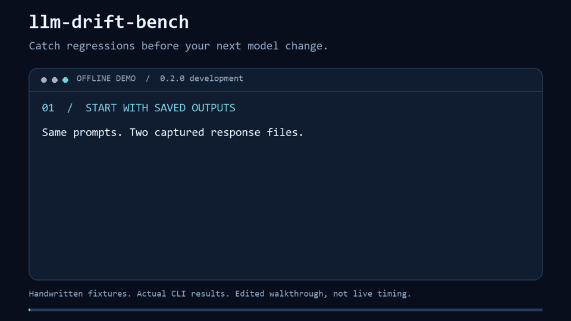
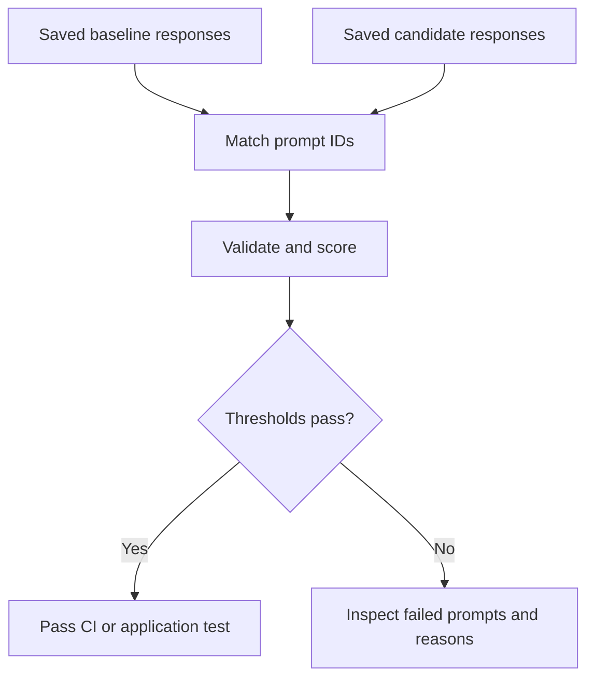

<div align="center">

# llm-drift-bench

**Catch silent regressions before you swap or quantize your LLM.**

Offline regression checks for LLM outputs, structured responses, and model changes.

[](https://pypi.org/project/llm-drift-bench/)
[](https://github.com/anant-goel/llm-drift-bench/actions/workflows/ci.yml)
[](pyproject.toml)
[](LICENSE)

[Quickstart](#quickstart) · [Examples](examples/README.md) · [Architecture](docs/architecture.md) · [Roadmap](docs/roadmap.md) · [Contribute](CONTRIBUTING.md)

</div>

> **Release status:** This checkout develops **0.3.0** (`0.3.0.dev0`). Registry publication
> is a separate step; the PyPI badge shows the published version.
> Read the [migration notes](docs/migration-0.2.md) before upgrading.

## See it in 18 seconds

[](docs/assets/demo.mp4)

[Watch or download the MP4](docs/assets/demo.mp4) | [Static preview](docs/assets/demo-poster.png) | [Demo inputs](examples/README.md)

This edited walkthrough uses actual CLI results from the **0.2.0 development
checkout** and handwritten fixtures. It is not a real-model benchmark or a
recording of execution speed. No audio is required. Open the static preview if
you prefer no animation.

## A faster model is only useful if its outputs still work

A quantized model can return valid JSON while changing a price, dropping a field,
or choosing a different label. A prompt revision can change output formatting
without improving the underlying task. A model update can affect both.

`llm-drift-bench` compares saved baseline and candidate responses by prompt ID
and makes those changes inspectable. It runs locally, with no model API calls,
API keys, embedding downloads, or GPU requirement. Its runtime dependencies are
Pydantic and Rich, plus their transitive dependencies.

| Check | What it tells you |
| --- | --- |
| JSON conformity | Whether responses parse and satisfy the supported schema subset |
| Text similarity | Token, n-gram, and character-level agreement with your baseline |
| JSON field agreement | Changes to structure, exact leaf values, and numeric values |
| Recorded latency | P50/P95 differences when complete measurements are supplied |
| CI gates | Whether a sample or suite exceeds your configured thresholds |

**Agreement is not correctness.** A wrong baseline can agree perfectly with a
wrong candidate. These metrics are lexical and structural, not a semantic judge.

## From captured responses to a release decision



### Evaluate the output your application depends on

| Your workflow | What you can compare today | What needs separate evaluation |
| --- | --- | --- |
| Model updates and quantization | Saved responses for the same prompts | General intelligence or factual accuracy |
| JSON extraction | Required fields, structure, field agreement, numeric changes | Whether extracted facts match the source |
| RAG applications | Saved final answers or structured extraction outputs | Retrieval relevance, grounding, and citation correctness |
| Agent workflows | Saved final responses or tool-argument JSON represented as output strings | Tool execution, intermediate traces, permissions, and task completion |

You export the captures; the benchmark evaluates them offline. See
[workflow recipes](docs/workflows.md) for examples and boundaries.

### Available now and planned next

| Capability | 0.2.0 | Direction |
| --- | --- | --- |
| Offline evaluation and JSON checks | Available | Harden schema and numeric handling |
| CLI and Python test gates | Available | Add CI-native result exports |
| Per-prompt failure inspection | Available | Canonical scores across CLI formats |
| Local HTML report | Available | Inspect a saved engine result in a browser |
| Run history and trends | Planned | Compare versioned results over time |
| Trace import and correlation | Exploratory | Connect failures to externally captured spans |
| Live production monitoring | Not implemented | Requires collection, storage, alerting, and operational design |

The next release prioritizes trustworthy results. The local HTML report shows
the same engine scores and failure decision as the CLI. Live monitoring and
historical dashboards remain separate future work.

## Quickstart

Try this checkout from PowerShell with Python 3.10 or newer:

```powershell
git clone https://github.com/anant-goel/llm-drift-bench.git
Set-Location llm-drift-bench
python -m venv .venv
& .\.venv\Scripts\python.exe -m pip install -e .
& .\.venv\Scripts\python.exe -m llm_drift_bench --version
& .\.venv\Scripts\python.exe -m llm_drift_bench run -b examples/baseline.jsonl -c examples/candidate-pass.jsonl -p examples/extraction-suite.json
```

Expected: `0.3.0.dev0`, followed by a **PASSED** comparison and exit code `0`.
On Linux/macOS, replace `.\.venv\Scripts\python.exe` with `.venv/bin/python`.
No virtual-environment activation is needed.

Now catch a regression:

```powershell
& .\.venv\Scripts\python.exe -m llm_drift_bench run -b examples/baseline.jsonl -c examples/candidate-drift.jsonl -p examples/extraction-suite.json --output drift-report.json
$LASTEXITCODE # Expected: 1
```

These fixtures are **handwritten demonstrations**, not measurements of any real
model or quantization. [Inspect the inputs and expected reports](examples/README.md).

To install the published version instead:

```powershell
python -m pip install "llm-drift-bench==0.1.0"
python -m llm_drift_bench --help
```

Published 0.1.0 does not include all changes documented on this branch.

## Bring your own captures

Create a JSON or JSONL file for each comparison target. Each record contains a
unique, nonempty `prompt_id` and the captured response as an `output` string:

```json
{"prompt_id":"invoice-01","model_name":"my-baseline","output":"{\"total\":100}"}
```

Optionally include measured `latency_ms` and `tokens_generated`. Missing
measurements remain unavailable; the tool does not estimate them from text.
Baseline and candidate must have exactly matching prompt IDs. A supplied suite
must cover the same IDs, with no duplicates or extra cases.

A suite associates those IDs with prompts and schemas:

```json
[{"prompt_id":"invoice-01","prompt":"Extract the invoice total.","schema":{"type":"object","required":["total"],"properties":{"total":{"type":"number","minimum":0}}}}]
```

JSON Schema support is intentionally limited. Unsupported keywords fail
explicitly. See [current limitations](docs/current-limitations.md) before using
complex schemas or untrusted regex patterns.

## Use it in CI

```powershell
& .\.venv\Scripts\python.exe -m llm_drift_bench run -b baseline.jsonl -c candidate.jsonl -p prompts.json --max-drift 0.15 --min-conformity 0.98 --max-numeric-drift 0.05 --max-latency-regression 25 --format json --output drift-report.json
exit $LASTEXITCODE
```

| Exit code | Meaning |
| --- | --- |
| `0` | Passed |
| `1` | Drift or a threshold failure |
| `2` | Usage or input error |

`--fail-on-drift` explicitly enables the default. `--no-fail-on-drift` makes a
run informational, but its report still records failure. Input errors remain
errors. A failed individual sample fails the suite even if the mean is low.

| Threshold | Default |
| --- | ---: |
| `--max-drift` | 0.25 |
| `--min-conformity` | 0.95 |
| `--max-numeric-drift` | 0.15 |
| `--max-latency-regression` | 50 percent |

Calibrate thresholds using your own tasks. Missing timings skip the latency
gate, so a passing report does not necessarily certify latency performance.

## Python API

```python
from llm_drift_bench import DriftBenchmarkEngine, ModelSample, PromptCase

suite = [PromptCase(prompt_id="invoice-01", prompt="Extract total.",
                    schema={"type": "object", "required": ["total"]})]
baseline = [ModelSample(prompt_id="invoice-01", output='{"total":100}')]
candidate = [ModelSample(prompt_id="invoice-01", output='{"total":100}')]
report = DriftBenchmarkEngine().evaluate(baseline, candidate, suite)
assert report.passed, report.failure_reasons
```

## Turn a benchmark into an automated test

The development version includes `assert_no_drift`, usable with pytest,
unittest, or ordinary Python. It uses the canonical engine report and raises
`AssertionError` when a sample or suite gate fails.

```python
from pathlib import Path
from llm_drift_bench import (
    DriftBenchmarkEngine, assert_no_drift, load_model_samples, load_prompt_cases,
)


def test_saved_outputs_do_not_regress():
    fixtures = Path("examples")  # Run from the repository root.
    report = DriftBenchmarkEngine().evaluate(
        load_model_samples(fixtures / "baseline.jsonl"),
        load_model_samples(fixtures / "candidate-pass.jsonl"),
        load_prompt_cases(fixtures / "extraction-suite.json"),
    )
    assert_no_drift(report)
```

Switch the candidate to `candidate-drift.jsonl` to see a failing assertion.
Failure messages include suite reasons and up to five failed prompt IDs, without
printing captured response bodies. The helper does not recompute scores or
add new checks; missing timings still mean the latency gate may be skipped.
It is not available in published 0.1.0.

## Commands and reporting

| Command | Purpose |
| --- | --- |
| `run` | Compare captured baseline and candidate outputs |
| `validate --strict` | Fail when captured outputs do not conform |
| `report` | Render an existing result |
| `init-sample --dir demo` | Create illustrative starter files |

All `run` formats now render the same engine result: table, JSON, Rich, Markdown,
and HTML. Saved engine reports preserve scores, thresholds, and failure reasons.
Legacy evaluator reports retain their original scoring semantics and are not
converted into engine reports.
For all options, run `python -m llm_drift_bench <command> --help`.

## Inspect results in your browser

Generate a report, then render it as a standalone HTML file:

```powershell
& .\.venv\Scripts\python.exe -m llm_drift_bench run -b examples/baseline.jsonl -c examples/candidate-drift.jsonl -p examples/extraction-suite.json -o drift-report.json
# Exit 1 is expected for this failing fixture; the JSON report is still saved.
& .\.venv\Scripts\python.exe -m llm_drift_bench report -i drift-report.json --format html -o drift-report.html
Start-Process -FilePath (Resolve-Path -LiteralPath drift-report.html).Path
```

The report includes the pass/fail result, summary metrics, per-prompt rows,
thresholds, failure reasons, and skipped-latency notices. It contains no scripts
or external assets and works offline. This is a saved report, not a live dashboard.
`run --output` always saves JSON, regardless of its stdout format; use
`report --format html --output` to save HTML.

[Download an example HTML report](docs/assets/example-report.html).

## Help make model changes safer

### Check an agent's workflow offline

The development Python API includes `check_read_before_edit`: verify that a
required file section was returned before an agent's first edit attempt.
It consumes normalized tool events and returns PASS, FAIL, or UNKNOWN.
Repeated reads count only once; incomplete traces cannot pass.
This checks content delivery, not comprehension, and does not collect live traces.
Run it with `llm-drift-bench check-tools`, then attach the saved verdict to HTML or
Markdown reports with `--tool-check`. See the
[tool-event guide and example](docs/tool-events.md).

Useful contributions include a small failing capture, a reproducible bug report,
a tested edge-case fix, or clearer documentation. Start with the
[contributor guide](CONTRIBUTING.md) and [roadmap](docs/roadmap.md).

If the tool catches a real regression, share a sanitized reproduction and the
benchmark version. Reproducible examples help other users more than a score
without its inputs.

[Changelog](CHANGELOG.md) · [Migration guide](docs/migration-0.2.md) · [MIT license](LICENSE)

## JUnit reports for CI (0.3.0 development)

Generate JSON and JUnit XML together while viewing the comparison in your terminal:

```powershell
& .\.venv\Scripts\python.exe -m llm_drift_bench run -s examples/extraction-suite.json -b examples/baseline.jsonl -c examples/candidate-pass.jsonl -o result.json --junit-output junit.xml
```

From the repository root, try the exporter with a bundled report:

```powershell
& .\.venv\Scripts\python.exe -m llm_drift_bench report -i examples/expected-pass.json --format junit -o junit.xml
Get-Content junit.xml
```

To generate a new result from captures and export it:

```powershell
llm-drift-bench run -b examples/baseline.jsonl -c examples/candidate-drift.jsonl -p examples/extraction-suite.json -o result.json
$DriftExit = $LASTEXITCODE
llm-drift-bench report -i result.json --format junit -o junit.xml
# Preserve $DriftExit as the CI gate; rendering a saved report exits 0.
```

JUnit contains one test per prompt plus a `benchmark_gate` test. A failing
benchmark therefore produces an extra failure in addition to any drifted prompts.
This preserves suite-only latency failures. Model latencies are not test execution
times, so no `time` attributes are invented. Raw captured responses are excluded;
prompt IDs and failure reasons are included. XML-invalid characters are replaced.
Legacy evaluator reports and `--tool-check` attachments are not supported in this
format. `run --format junit` writes XML to stdout; its `-o` still saves JSON.

In GitHub Actions, add `--github-summary` to a `run` command to append the verdict,
drifted prompt count, mean drift and candidate conformity to the job summary.
The usual drift exit code still applies.

## Explain a saved comparison

Run these commands from the repository root to inspect the two shipped examples.

```powershell
python -m llm_drift_bench diagnose -i examples/expected-drift.json
python -m llm_drift_bench diagnose -i examples/expected-pass.json --format json
```

The failing example identifies the missing priority field on `ticket-01` and a
numeric change on `invoice-01`. Each finding suggests a check you can perform.
Missing timings also appear on a passing report. Use `--limit 5` to shorten the
output. Diagnosis exits 0 when it renders successfully, including for a failed
comparison. Use the benchmark run command for CI gating.

### Optional local AI suggestions

From a source checkout, install the AI extra in an environment supported by
OpenVINO GenAI. Supply a compatible, already exported OpenVINO language model
directory containing its model and tokenizer. Device availability depends on the
model, installed runtime, hardware and drivers. Run device discovery first.

```powershell
python -m pip install ".[ai]"
python -m llm_drift_bench ai-devices
python -m llm_drift_bench diagnose -i examples/expected-drift.json --ai-model "D:\Models\my-openvino-model" --device CPU
```

Choose CPU (default), GPU or NPU. The GPU and NPU paths use OpenVINO-supported
hardware. The model receives category counts and a fixed menu of checks. It can
prioritize up to three. If it returns an invalid selection, the CLI shows checks
in report order. Captured responses, prompt IDs and field values stay out of its input.
It cannot change the verdict or edit files. If inference fails, the command
returns 2 and still shows the deterministic findings.
